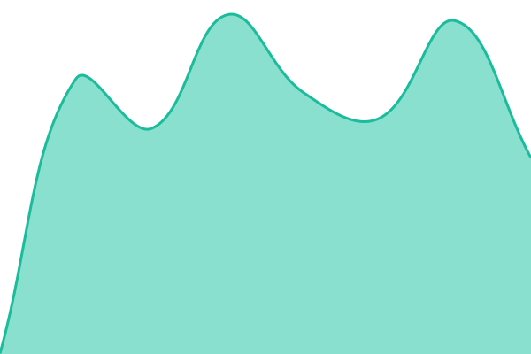
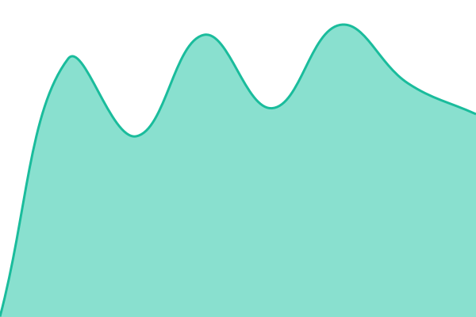

# [📈 Live Status](https://status.hahmann-trier.de): <!--live status--> **🟩 All systems operational**

This repository contains the open-source uptime monitor and status page for [Lucas Hahmann](https://www.hahmann-trier.de), powered by [Upptime](https://github.com/upptime/upptime).

With [Upptime](https://upptime.js.org), you can get your own unlimited and free uptime monitor and status page, powered entirely by a GitHub repository. We use [Issues](https://github.com/lucashahmann/uptime-hahmann-trier-de/issues) as incident reports, [Actions](https://github.com/lucashahmann/uptime-hahmann-trier-de/actions) as uptime monitors, and [Pages](https://status.hahmann-trier.de) for the status page.

<!--start: status pages-->
<!-- This summary is generated by Upptime (https://github.com/upptime/upptime) -->
<!-- Do not edit this manually, your changes will be overwritten -->
<!-- prettier-ignore -->
| URL | Status | History | Response Time | Uptime |
| --- | ------ | ------- | ------------- | ------ |
|  [Wordpress](https://www.hahmann-trier.de) | 🟩 Up | [wordpress.yml](https://github.com/LucasHahmann/uptime-hahmann-trier-de/commits/HEAD/history/wordpress.yml) | 

 650ms
     
 | 

<a href="https://status.hahmann-trier.de/history/wordpress">100.00%</a>
    

|  [Nextcloud](https://cloud.hahmann-trier.de/status.php) | 🟩 Up | [nextcloud.yml](https://github.com/LucasHahmann/uptime-hahmann-trier-de/commits/HEAD/history/nextcloud.yml) | 

 904ms
     
 | 

<a href="https://status.hahmann-trier.de/history/nextcloud">83.49%</a>
    

|  [Gitea](https://git.hahmann-trier.de/api/healthz) | 🟩 Up | [gitea.yml](https://github.com/LucasHahmann/uptime-hahmann-trier-de/commits/HEAD/history/gitea.yml) | 

 522ms
     
 | 

<a href="https://status.hahmann-trier.de/history/gitea">100.00%</a>
    

|  [BookStack Wiki](https://wiki.hahmann-trier.de/status) | 🟩 Up | [book-stack-wiki.yml](https://github.com/LucasHahmann/uptime-hahmann-trier-de/commits/HEAD/history/book-stack-wiki.yml) | 

 617ms
     
 | 

<a href="https://status.hahmann-trier.de/history/book-stack-wiki">100.00%</a>
    

|  [HedgeDoc](https://hedgedoc.hahmann-trier.de) | 🟩 Up | [hedge-doc.yml](https://github.com/LucasHahmann/uptime-hahmann-trier-de/commits/HEAD/history/hedge-doc.yml) | 

 639ms
     
 | 

<a href="https://status.hahmann-trier.de/history/hedge-doc">100.00%</a>
    

|  [Stirling PDF](https://pdf.hahmann-trier.de/api/v1/info/status) | 🟩 Up | [stirling-pdf.yml](https://github.com/LucasHahmann/uptime-hahmann-trier-de/commits/HEAD/history/stirling-pdf.yml) | 

 486ms
     
 | 

<a href="https://status.hahmann-trier.de/history/stirling-pdf">100.00%</a>
    

|  [Mailcow](https://pmg.hahmann-trier.de) | 🟩 Up | [mailcow.yml](https://github.com/LucasHahmann/uptime-hahmann-trier-de/commits/HEAD/history/mailcow.yml) | 

 769ms
     
 | 

<a href="https://status.hahmann-trier.de/history/mailcow">100.00%</a>
    

|  [Monitoring](https://monitoring.hahmann-trier.de) | 🟩 Up | [monitoring.yml](https://github.com/LucasHahmann/uptime-hahmann-trier-de/commits/HEAD/history/monitoring.yml) | 

 938ms
     
 | 

<a href="https://status.hahmann-trier.de/history/monitoring">100.00%</a>
    

|  [Grafana](https://grafana.hahmann-trier.de/api/health) | 🟩 Up | [grafana.yml](https://github.com/LucasHahmann/uptime-hahmann-trier-de/commits/HEAD/history/grafana.yml) | 

 567ms
     
 | 

<a href="https://status.hahmann-trier.de/history/grafana">100.00%</a>
    

|  [PatchMon](https://patch.hahmann-trier.de/health) | 🟩 Up | [patch-mon.yml](https://github.com/LucasHahmann/uptime-hahmann-trier-de/commits/HEAD/history/patch-mon.yml) | 

 453ms
     
 | 

<a href="https://status.hahmann-trier.de/history/patch-mon">100.00%</a>
    

|  [What's up Docker](https://wud.hahmann-trier.de) | 🟩 Up | [what-s-up-docker.yml](https://github.com/LucasHahmann/uptime-hahmann-trier-de/commits/HEAD/history/what-s-up-docker.yml) | 

 479ms
     
 | 

<a href="https://status.hahmann-trier.de/history/what-s-up-docker">100.00%</a>
    

|  [Game Panel](https://game-panel.hahmann-trier.de) | 🟩 Up | [game-panel.yml](https://github.com/LucasHahmann/uptime-hahmann-trier-de/commits/HEAD/history/game-panel.yml) | 

 509ms
     
 | 

<a href="https://status.hahmann-trier.de/history/game-panel">100.00%</a>
    

|  [Wings](https://wings.hahmann-trier.de) | 🟩 Up | [wings.yml](https://github.com/LucasHahmann/uptime-hahmann-trier-de/commits/HEAD/history/wings.yml) | 

 440ms
     
 | 

<a href="https://status.hahmann-trier.de/history/wings">100.00%</a>
    

|  [Foundry VTT](https://foundry.hahmann-trier.de) | 🟩 Up | [foundry-vtt.yml](https://github.com/LucasHahmann/uptime-hahmann-trier-de/commits/HEAD/history/foundry-vtt.yml) | 

 1345ms
     
 | 

<a href="https://status.hahmann-trier.de/history/foundry-vtt">100.00%</a>
    

|  [ATM10 Stats](https://stats.hahmann-trier.de/api/health) | 🟩 Up | [atm-10-stats.yml](https://github.com/LucasHahmann/uptime-hahmann-trier-de/commits/HEAD/history/atm-10-stats.yml) | 

 514ms
     
 | 

<a href="https://status.hahmann-trier.de/history/atm-10-stats">100.00%</a>
    

|  [Deepwater Survival](https://www.deepwatersurvival.de) | 🟩 Up | [deepwater-survival.yml](https://github.com/LucasHahmann/uptime-hahmann-trier-de/commits/HEAD/history/deepwater-survival.yml) | 

 787ms
     
 | 

<a href="https://status.hahmann-trier.de/history/deepwater-survival">100.00%</a>
    

|  [Deepwater Cloud](https://cloud.deepwatersurvival.de) | 🟩 Up | [deepwater-cloud.yml](https://github.com/LucasHahmann/uptime-hahmann-trier-de/commits/HEAD/history/deepwater-cloud.yml) | 

 762ms
     
 | 

<a href="https://status.hahmann-trier.de/history/deepwater-cloud">100.00%</a>
    

|  [Deepwater Cash](https://cash.deepwatersurvival.de) | 🟩 Up | [deepwater-cash.yml](https://github.com/LucasHahmann/uptime-hahmann-trier-de/commits/HEAD/history/deepwater-cash.yml) | 

 1330ms
     
 | 

<a href="https://status.hahmann-trier.de/history/deepwater-cash">100.00%</a>
    

|  [Athenia Wiki](https://athenia.wiki) | 🟩 Up | [athenia-wiki.yml](https://github.com/LucasHahmann/uptime-hahmann-trier-de/commits/HEAD/history/athenia-wiki.yml) | 

 921ms
     
 | 

<a href="https://status.hahmann-trier.de/history/athenia-wiki">100.00%</a>
    

|  [Rackaris](https://www.rackaris.de) | 🟩 Up | [rackaris.yml](https://github.com/LucasHahmann/uptime-hahmann-trier-de/commits/HEAD/history/rackaris.yml) | 

 658ms
     
 | 

<a href="https://status.hahmann-trier.de/history/rackaris">100.00%</a>
    

<!--end: status pages-->

[**Visit our status website →**](https://status.hahmann-trier.de)

## 📄 License

- Powered by: [Upptime](https://github.com/upptime/upptime)
- Code: [MIT](./LICENSE) © [Anand Chowdhary](https://anandchowdhary.com), supported by [Pabio](https://pabio.com)
- Data in the `./history` directory: [Open Database License](https://opendatacommons.org/licenses/odbl/1-0/)
